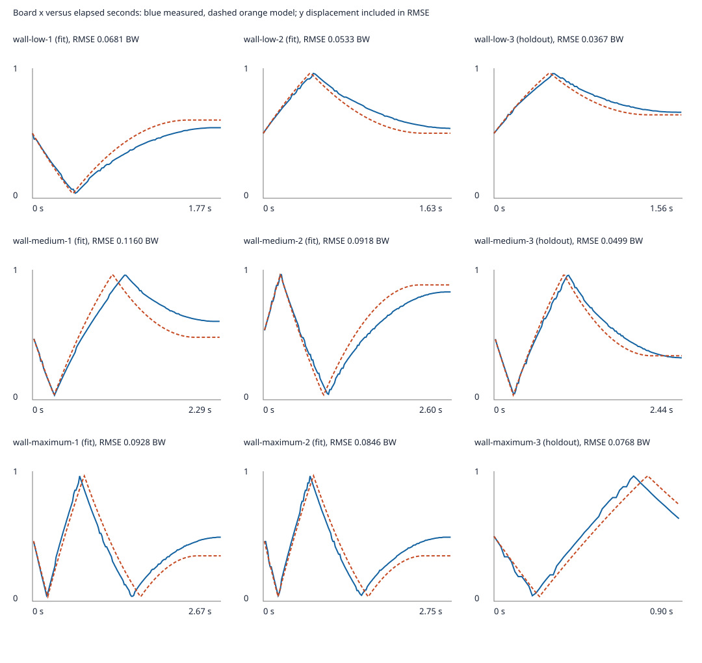

# Offline recording calibration v1

CB-37, 2026-11-17. **Report only: no usable real-game profile. Live aiming remains
unavailable.** All three held-out wall shots exceed the predeclared trajectory
target. This is a measured failure to validate the combined constant-drag,
linear-arrow-proxy and fixed normal-wall model, not proof of a particular replacement
physics model or of an incorrect game implementation.

CB-38 follow-up: [training-only timing/model comparison](calibration/comparison.md),
[prior-art audit](calibration/prior-art.md) and
[controlled phone acquisition](calibration/controlled-phone-protocol.md). The v1
annotations, split and historical report below remain unchanged.

The authorized source is Miniclip Carrom Pool: Disc Game (`com.miniclip.carrom`),
Nothing Phone (2a). Game version, equipment identity and physical dimensions are
unknown. No media, account data or machine source paths are repository assets.
See [scale decision](adr/0026-offline-relative-calibration.md) and
[executed validation](validation-cb-37.md).

## Evidence and format

[plan.json](calibration/recordings-v1/plan.json) declared the split, bounds and
exploratory targets before parameter estimation. Repetitions 1/2 at each wall label
fit; repetition 3 at every label is held out. Labels are approximate user inputs.
No break or held-out shot enters fitting, optimizer seed selection or sensitivity
refitting. There are six fit, three held-out wall and three exploratory break shots.
Per-shot launch directions use measured displacement 0.05–0.15s after the release
proxy (including held-out directions); thus these are conditional trajectory
comparisons with measured initial conditions, not blind predictions from UI aim
alone. Arrow lengths are annotated from pre-release frames. No held-out speed,
drag, loss or release correction is fitted. Break direction is assumed vertical.

[measurements.json](calibration/recordings-v1/measurements.json), version 1, contains:

- Dataset/device/package identity, explicit unknowns, per-clip SHA-256, time base,
  frame counts, PTS bounds/gaps, resolution and exact board-crop duplicate counts.
- Manually reviewed inner rails `[20,490,700,1170]` pixels, striker radius 23px,
  disc radius 18px, nominal geometry/centre uncertainty ±3px. These are visual
  estimates, not independently labeled ground truth or physical dimensions.
- Each shot's split, release **display proxy**, usable interval, measured launch
  direction, pullback-proxy annotation frame/length ±5px, timestamped centres,
  missing marker/repeated-centre diagnostics, release/wall/rest events and exclusions.
- Break approach samples and visual first-rack-motion brackets; no invented disc
  identities through occlusion. These brackets are conservative visual diagnostics,
  not solver-resolved first contact times.

1 board width (BW)=680px between reviewed inner rails. Square coordinates are
`x=(pixelX-20)/680`, `y=(pixelY-490)/680`; +x right/+y down. Striker radius is
23/680 BW. Coordinate uncertainty is nominally 0.00441 BW, event extrema ±5px or
0.00735 BW. Static geometry was reviewed across clips; there is no perspective
homography fit. The red marker's bounding-box centre has a +5px vertical correction
to the visible striker-body centre; a fixed sprite offset may add systematic error.
This method is restricted to this appearance and these reviewed lane windows.

Arrow shaft+head length/BW is a visible pullback proxy. It has no independently
known normalized-power/full-scale relationship. Measured arrow lengths for wall
repetitions 1/2/3 are low 80/76/70px, medium 108/118/112px and maximum 128/128/128px.
Break proxies are 66/98/128px. The striker does not visibly translate backwards;
the graphic proxy must not be described as a measured physical gesture or exact
game power. Approximate/manual endpoints are intentionally retained with uncertainty.

## Timestamp and segment handling

Decode in presentation order using `frame.pts * frame.time_base`, never frame/fps.
Missing/nonmonotonic PTS fail extraction. Timestamp gaps remain explicit. Across
the six sources, adjacent encoded intervals range 0.00550–0.06687s. All board-crop
exact-repeat counts are zero; compression/UI animation can change pixels even
when bodies hold still. Within the usable wall intervals, 128 successive centre
pairs are exactly unchanged. These are diagnostics, not a count of distinct game
updates. No resampling or missing-marker interpolation is performed.

Each recorded release uses the last reviewed stationary/aiming display PTS. The
engine may already have advanced by one or two updates on the first moving frame;
release uncertainty is ±0.0334s. Do not infer exact impulse time from that proxy.
The training-only release sensitivity uses coherent ±0.0334s shifts. No release
time is optimized to improve held-out agreement.

All nine wall shots have measured pre-impact and post-impact centres. The three
low shots show one rail reversal; medium shots two; maximum fit shots three.
Maximum holdout has two observed reversals before 30.45s; later motion is excluded
conservatively for possible rack interaction. Five marker observations at interval
edges fail the narrow colour/shape gate and remain missing. Aiming, moving aim
graphics, rack/UI animations, fades and turn-reset teleports stay outside fitting
windows. A large within-window jump fails a speed/reset guard rather than becoming
drag evidence. Ambiguous contact samples within 0.05s of a rail reversal are excluded
from local quadratic diagnostics, but retained in whole-trajectory scoring.

Rail events are sampled x extrema corroborated by substantial reversal on both
sides over about 0.1s. They are not exact subframe contacts. Rest is a display
resolution proxy: first centre within 2px of every remaining centre, corroborated
for at least 0.08s before animation. Low repetition 2 has no qualifying rest evidence
before its chosen clean endpoint; maximum repetition 3 is truncated. Their stop
metrics are unavailable, never successful zero-error measurements.

## Fit, comparison and result

The bounded deterministic coarse grid and five simplex starts minimize mean squared
2D centre error over **training samples only**. Fixed iteration/tie order and no
randomness/wall clock enter fitting. This is a local numerical search, not proof of
a global optimum. `report.json` retains residuals, counts, all order-matched bounce
errors and unconstrained local quadratic diagnostics, including negative/implausible
results rather than clipping them into plausible physics.

The combined fit is drag **0.966966 BW/s²**, arrow-length gain **12.017364 s⁻¹**
(`launch speed = gain * arrowLengthBW`) and normal restitution **1.0 at its bound**.
These are rejected model-fit values, not recommended settings. The predeclared
targets were trajectory RMSE ≤0.02 BW; bounce time/position error ≤0.05s/0.02 BW;
rest time/position error ≤0.15s/0.03 BW. Missing values cannot pass.

| Held-out shot | Samples | Trajectory RMSE BW | Max error BW | First bounce error s | Rest time error s | Rest position error BW |
| --- | ---: | ---: | ---: | ---: | ---: | ---: |
| low-3 | 94 | 0.03674 | 0.05917 | -0.02449 | -0.15450 | 0.02167 |
| medium-3 | 146 | 0.04988 | 0.08600 | -0.01648 | -0.30298 | 0.01337 |
| maximum-3 | 54 | 0.07678 | 0.10951 | +0.03288 | unavailable | unavailable |

Signed time errors are predicted minus measured proxy. First-bounce location errors
are 0.00792/0.01326/0.00901 BW. Medium/max held-out second-bounce timing also misses
0.05s (approximately -0.06/+0.07s). All matched event errors/counts are retained in
the JSON; unobserved later predicted bounces are not credited as validated.
See [all nine tables](calibration/recordings-v1/metrics.md) and numeric-only plots:



Long terminal segments have local deceleration near 0.59–0.65 BW/s². Several short
early segments give wildly different or even negative estimates, with large
coordinate/timing sensitivity; local normal speed ratios can exceed one. These
are signs of short-window/display aliasing/model uncertainty, not measured energy
creation. A quadratic model extrapolated from a short interval is not an independent
restitution measurement. `deceleration_coordinate_sensitivity_bw_s2` gives the
worst-case linear coefficient perturbation for independent ±3px centre errors;
it excludes timestamp, sprite and geometry systematics. No statistical confidence
intervals or calibrated success probabilities are claimed.

[sensitivity.json](calibration/recordings-v1/sensitivity.json) refits only training
shots after coherent ±5px arrow changes or ±0.0334s release changes. Drag spans
0.8831–1.0571 BW/s², gain 11.4702–12.5663 s⁻¹; normal restitution stays at 1.0.
These perturbation ranges are not confidence bounds. The linear proxy and shared
drag/loss assumptions are evaluated together; their separate causal errors cannot
be identified here. Near-normal rails cannot identify tangent loss/friction.
The replay assumes tangent retention 1/friction 0 explicitly; they remain unknown.

The production Kotlin `ShotSimulator` is replayed at fixed 1ms steps with a 30s
budget and linear interpolation to actual observation times. Every position,
radius, velocity and drag is scaled by **1000 arbitrary reference units/BW** to
existing mm-labelled APIs. That conversion is not a measured mm board. Python
analytic/production discrepancy is checked ≤0.002 BW, accounting for interpolation
across contacts. Exact executed discrepancies are in the validation log summary.

## Break disposition and precise remaining gaps

Each break clip contains one fresh-rack shot. `break-medium` also includes menus,
new-game setup and later overlays; those frames have no trajectory meaning.
Only pre-rack striker centres with a full strong marker are scored, after wall
fitting. Min/medium/max respectively supply 8/5/3 samples over 0.1166/0.06653/0.03353s.
Mean measured approach speeds are 1.0095/1.1502/2.3901 BW/s; proxy-predicted launch
speeds 1.1664/1.7319/2.2621 BW/s. Approach RMSE is 0.00705/0.01340/0.00488 BW.
These short, timestamp-sensitive intervals and subsequent visible rack scattering
are exploratory collision checks; they cannot validate full collision trajectories,
contact order, pocket behavior or body coefficients. The full rack's labelled
initial centres and persistent identities are unavailable after overlap.

**Blocker for a usable profile:** this measurement/model combination misses held-out
paths/stopping targets; proxy-to-game-power is unknown; short pre-impact segments
are timing sensitive; tangential/body/pocket parameters remain unidentified.
The report deliberately emits `rejected_for_use_model_or_measurement_mismatch`,
not an importable profile. There is no change to app behavior or synthetic settings.

Analysis now identifies these specific useful follow-ups, without requesting another
recording as a prerequisite for this report: independently log the game's power
input (or a stable full-range graphic reference), record longer collision-free
striker travel at several measured inputs with repeated shots and visible rest,
and obtain controlled oblique single-rail shots to separate normal/tangential loss.
For body coefficients, use isolated one-disc contacts with clear identities rather
than rack breaks. Confirm game build/equipment before transferring any future
profile. A separate ticket should compare alternate drag/power models on a new
holdout; fitting additional parameters to these three holdouts would contaminate them.

## Reproduce

Python 3.10+; scoring, preparing, plotting and synthetic tests use only the standard
library. Media extraction additionally uses PyAV 19.0.2/Pillow 13.0.0 from
`tools/calibration/requirements-media.txt`. Install into a private environment; do
not add packages to Kotlin libraries. Keep source videos and optional review crops
external/read-only. Set `$source` to a source directory locally; never commit it.

```powershell
py -m unittest discover -s tools/calibration -v
foreach ($name in @('wall-low','wall-medium','wall-maximum','break-min','break-medium','break-max')) {
  py tools/calibration/extract.py "$source/$name.mp4" --output ".validation/cb37-$name.json"
  if ($LASTEXITCODE -ne 0) { throw "Extraction failed" }
}
py tools/calibration/prepare.py .validation --output docs/calibration/recordings-v1/measurements.json
py tools/calibration/analyze.py docs/calibration/recordings-v1/measurements.json --output docs/calibration/recordings-v1/report.json
py tools/calibration/sensitivity.py docs/calibration/recordings-v1/measurements.json --output docs/calibration/recordings-v1/sensitivity.json
py tools/calibration/render.py docs/calibration/recordings-v1
.\gradlew.bat -PjvmOnly :core:physics:replayCalibration '-PcalibrationInput=docs/calibration/recordings-v1/replay.csv'
```

Unix: use `python3` and `./gradlew`. Media decoding is optional when rescoring the
checked-in numeric annotations. Same measurement/configuration inputs reproduce
report parameters/metrics within 1e-8 absolute; byte identity is expected on the
recorded Python runtime. Native decoder versions/colour conversion can affect pixel
thresholds: pin dependencies and review manual windows/uncertainty for a new dataset.
Version changes must retain old results; annotations are not silently corrected
using held-out residuals. The Python report is a small schema-v1 JSON artifact,
not a production profile schema or Android import format.
