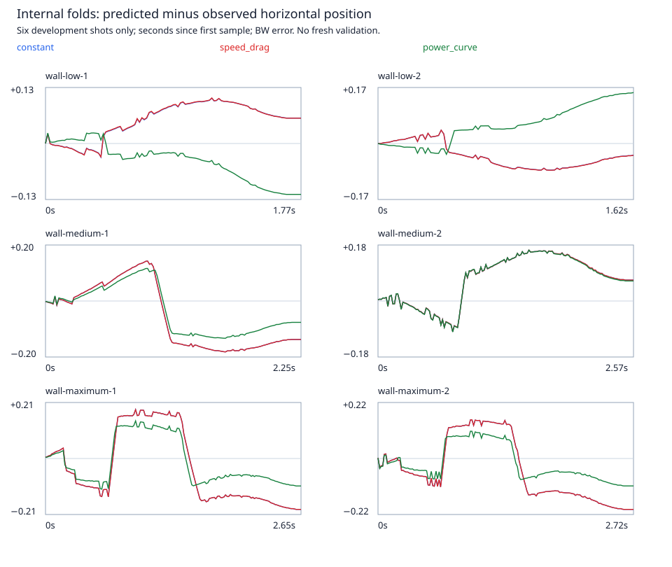

# Internal shot cross-validation, comparison v1

Development shots only; these are not fresh independent validation. Equal shot weighting. Errors in BW; times in seconds.

| Candidate | CV RMSE | Full training RMSE | Follow-up |
| --- | ---: | ---: | --- |
| constant | 0.10897912 | 0.08636501 | not selected |
| speed_drag | 0.10903237 | 0.08636501 | not selected |
| power_curve | 0.08393731 | 0.06038259 | selected hypothesis only |

| Candidate | Omitted shot | RMSE | Max error | Bounces observed/predicted | Max matched bounce time/position error | Rest time/position error |
| --- | --- | ---: | ---: | ---: | ---: | ---: |
| constant | wall-low-1 | 0.06697 | 0.10475 | 1/1 | 0.02060/0.00607 | -0.16660/0.06046 |
| constant | wall-low-2 | 0.05143 | 0.07902 | 1/1 | 0.02373/0.00588 | unavailable/unavailable |
| constant | wall-medium-1 | 0.12679 | 0.18150 | 2/2 | 0.15661/0.01040 | -0.14755/0.13954 |
| constant | wall-medium-2 | 0.10528 | 0.16702 | 2/2 | 0.07915/0.00954 | -0.30411/0.07036 |
| constant | wall-maximum-1 | 0.14119 | 0.19360 | 3/3 | 0.22346/0.00882 | -0.17876/0.19065 |
| constant | wall-maximum-2 | 0.13052 | 0.20157 | 3/3 | 0.17881/0.01277 | -0.21048/0.19863 |
| speed_drag | wall-low-1 | 0.06726 | 0.10517 | 1/1 | 0.02126/0.00607 | -0.16965/0.06014 |
| speed_drag | wall-low-2 | 0.05173 | 0.07940 | 1/1 | 0.02400/0.00588 | unavailable/unavailable |
| speed_drag | wall-medium-1 | 0.12679 | 0.18150 | 2/2 | 0.15661/0.01040 | -0.14755/0.13954 |
| speed_drag | wall-medium-2 | 0.10528 | 0.16702 | 2/2 | 0.07915/0.00954 | -0.30411/0.07036 |
| speed_drag | wall-maximum-1 | 0.14119 | 0.19360 | 3/3 | 0.22346/0.00882 | -0.17876/0.19065 |
| speed_drag | wall-maximum-2 | 0.13052 | 0.20157 | 3/3 | 0.17881/0.01277 | -0.21049/0.19863 |
| power_curve | wall-low-1 | 0.05975 | 0.11750 | 1/1 | 0.03126/0.00607 | -0.30264/0.11603 |
| power_curve | wall-low-2 | 0.07844 | 0.15126 | 1/1 | 0.05018/0.00588 | unavailable/unavailable |
| power_curve | wall-medium-1 | 0.09103 | 0.13300 | 2/2 | 0.12734/0.01040 | -0.18430/0.07897 |
| power_curve | wall-medium-2 | 0.10478 | 0.16693 | 2/2 | 0.08006/0.00954 | -0.31001/0.06752 |
| power_curve | wall-maximum-1 | 0.08912 | 0.14312 | 3/3 | 0.13604/0.00882 | -0.15243/0.10159 |
| power_curve | wall-maximum-2 | 0.07310 | 0.10865 | 3/3 | 0.09014/0.01277 | -0.17905/0.10571 |

Bounce errors are absolute maxima over order-matched observed/predicted events. Unmatched events and missing rest cannot pass. Signed per-event errors and time-stamped 2D residuals remain in report.json.

